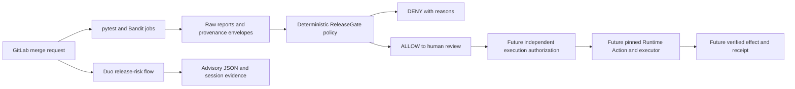

# ReleaseGate architecture — Phase 0 / Phase 1

Assessment date: 2026-10-13. Scope: a new Path A application. The completed local
slice makes release eligibility decisions; the competition integration and release
execution remain pending. It consumes no previous application's implementation.

## Smallest useful system

Only CI evidence reaches the deterministic policy. AI recommendations cannot
override its thresholds or supply approval facts. Phase 1 ends at human review;
`releasegate release` unconditionally returns DENY and exit 3. No service, frontend,
database, deployment endpoint or cloud account is required.

## Product contracts

- `run-check tests` executes pytest and parses its actual JUnit XML. Failed command,
  test failure, test error, inconsistent counts, or no passing tests is denied.
- `run-check security` executes Bandit over every Python file under `src`, with
  `--ignore-nosec`. Its JSON findings and metrics must agree. Parse errors, missing
  results, no scanned files, unsupported severities and unexpected exits fail closed.
  LOW/MEDIUM findings remain visible; HIGH/CRITICAL findings deny eligibility.
- Each check records the supplied 40-character commit SHA, the actual command, tool
  version, exit, raw report digest, source snapshot digest and execution context.
- `evaluate` rereads raw reports and recomputes summaries and hashes. Both checks
  must describe the same snapshot and, in CI, project/pipeline. Required reports are
  fixed paths; model output cannot select an artifact path or a tool executable.
- `ALLOW` at `eligibility` means `next_gate=HUMAN_APPROVAL`. `final` production
  evaluation requires trusted human approval facts bound to commit, target and the
  exact evidence digest. The CLI has no approval JSON or environment-variable bypass.
- The pure policy's `ApprovalFacts` input is an adapter contract, not an identity
  verifier. Tests exercise this contract. No production approval adapter exists yet.
  Even accepted facts only lead to `EXECUTION_AUTHORIZATION`, with
  `execution_authorized=false`. An LLM dictionary never counts as approval.

## Trust and limitations

The local SHA is a reference to Git HEAD, **not proof of a clean committed tree**.
Local artifacts explicitly say `local-working-tree`; the digest binds uncommitted
source too. Source identity covers Python files in `src` and `tests`, plus
`pyproject.toml`, `.gitlab-ci.yml` and `uv.lock`. Filesystem hashes detect accidental
mixing or modification; they are not signed attestations and cannot stop an attacker
who controls the code, reports and runner. Phase 2 must protect the default branch,
policy changes, runner, CI variables, artifacts and approver identity.

Bandit checks Python code patterns, not dependencies, container vulnerabilities,
secrets, external services or business logic. Its actual LOW subprocess findings are
retained. Commands are fixed and run without a shell. The sandbox scanner fixture
in the local DENY demonstration is never imported or executed.

## GitLab capabilities versus this environment

The current checkout has only GitHub `origin`; no GitLab project URL, glab command,
GitLab credential environment variable or connected browser surface was found.
The user confirmed onboarding is incomplete and is handling it in the web UI.
Account/project access, edition, credits, runner and permissions are **NOT VERIFIED**.

| Capability | Official support | Competition project validation |
|---|---|---|
| Custom agents | UI/AI Catalog prompt and explicit tool selection | NOT VERIFIED |
| Custom flows | Catalog-managed v1 YAML; own AgentComponents | Prepared YAML; platform NOT VERIFIED |
| Event triggers | Flows/external agents, not custom agents | Mention/Assign reviewer first; NOT VERIFIED |
| Read tools | MR, diffs, repository file, job logs, REST GET | Selected only; availability NOT VERIFIED |
| GitLab CI artifacts | Raw paths and pytest JUnit report | Local collection PASS; server NOT RUN |
| Manual job | Blocking with `allow_failure: false` | Config prepared; server NOT RUN |
| Protected deployment approval | Premium/Ultimate; separate approval and job run | Deferred; edition/rules NOT VERIFIED |
| Agent sessions | AI > Sessions, execution logs | NOT VERIFIED; no session fabricated |

Custom agents are created/enabled by Maintainers or Owners. For Phase 1, a custom
flow is preferable because it can later receive MR triggers. Custom flows cannot
call a separately created custom agent. [Custom agents](https://docs.gitlab.com/user/duo_agent_platform/agents/custom/),
[custom flows](https://docs.gitlab.com/user/duo_agent_platform/flows/custom/).

Definitions live in AI Catalog; a repository file does not install an integration.
The simplest registration path is to paste our flow into its editor and enable it.
Catalog publishing CI components exist, but add access and tag management that this
phase does not require. [AI Catalog](https://docs.gitlab.com/user/duo_agent_platform/ai_catalog/).

The flow uses `version: v1`, `environment: ambient`, inline prompts and a single
AgentComponent. It requests JSON text; server-enforced `response_schema_id` is
unsupported for custom flows, so it is deliberately absent. No guessed Duo REST
invocation or custom-agent YAML import is provided. [Custom flow restrictions](https://docs.gitlab.com/user/duo_agent_platform/flows/custom_flows_schema/),
[v1 specification](https://gitlab.com/gitlab-org/modelops/applied-ml/code-suggestions/ai-assist/-/blob/main/docs/flow_registry/v1.md).

Triggers are separately configured. Mention or Assign reviewer provides MR context;
pipeline events provide a webhook payload. Do not assume a universal MR-update event
or repository-config-path availability. Later automate pipeline Passed/Failed events
after validating their actual availability and payload. [Triggers](https://docs.gitlab.com/user/duo_agent_platform/triggers/).

Artifacts are retained on failures; a blocking manual job holds default-branch
candidates. It is a review of evidence, not authenticated production approval or a
deployment. Future protected-environment approval requires actual environment rules,
and approving a deployment does not itself start its job. [Job artifacts](https://docs.gitlab.com/ci/jobs/job_artifacts/),
[manual jobs](https://docs.gitlab.com/ci/jobs/job_control/),
[deployment approvals](https://docs.gitlab.com/ci/environments/deployment_approvals/).

## Shared Runtime constraint discovered before implementation

`AGENTS.md` remains byte-for-byte intact. Its required runtime is
`agentic-intent-gate` v0.1.0 at
`fd742b783058a53400c465b4ab59c6e80715895a`. Live `git ls-remote` confirmed the
annotated tag and peeled commit. The pinned tree contains no LICENSE/COPYING/NOTICE,
no licensing field in `pyproject.toml`, and no license declaration in README/docs.
The task expressly forbids depending on this package without independently verified
license compatibility. Consequently it is **not installed as this application's
dependency** and no runtime code is copied or reimplemented.

The pinned metadata also requires Python `>=3.13,<3.14`, incompatible with the
preferred 3.12 baseline. The exact pinned `examples/consumer/app.py` was read from
Git. Existing installed public API signatures were inspected separately; that
installation is editable from a later checkout, so it does **not** qualify as a
verified pinned install. See `runtime-feasibility.md` for concrete evidence and the
activation checklist. This is an explicit unresolved deviation from the dependency
instruction, rather than a silently substituted execution framework.

Once licensing and Python are resolved, compose one trusted `SIDE_EFFECT` tool
through the published Runtime. GitLab owns CI scheduling and Duo review; the shared
Runtime owns persistent Plan/Run/Approval/authorization/Action/receipt execution.
Its single-step scope cannot be treated as a generic multi-tool orchestration engine.
