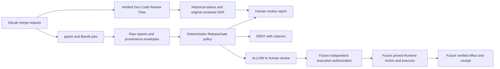

# ReleaseGate architecture — evidence, eligibility and human review

Initial assessment: 2026-10-13; current update: 2026-10-24.
Scope: a new Path A application. The completed local
slice makes release eligibility decisions. Real GitLab CI and foundational Duo
review are qualified; custom risk-flow registration and release execution remain
pending. It consumes no previous application's implementation.

## Smallest useful system

Only CI evidence reaches the deterministic policy. AI recommendations cannot
override its thresholds or supply approval facts. Phase 1 ends at human review;
`releasegate release` unconditionally returns DENY and exit 3. No service, frontend,
database, deployment endpoint or cloud account is required.

## Product contracts

- `run-check tests` executes pytest and parses its actual JUnit XML. Failed command,
  test failure, test error, inconsistent counts, or no passing tests is denied.
  Policy v2 also requires the reviewed `tests/required-tests.json` identity set.
  JUnit `classname::name` identities must be unique; all mandatory cases must be
  present. Extra passing tests cannot replace missing cases. Any skip denies; no
  allowlist is currently justified. Neither artifacts nor model output may choose
  required cases or waive skips. The trusted pure-policy caller supplies the set;
  the CLI reads only the fixed repository manifest and fails closed if unavailable.
- `run-check security` executes Bandit over every Python file under `src`, with
  `--ignore-nosec`. Its JSON findings and metrics must agree. Parse errors, missing
  results, no scanned files, unsupported severities and unexpected exits fail closed.
  LOW/MEDIUM findings remain visible; HIGH/CRITICAL findings deny eligibility.
- Each check records the supplied 40-character commit SHA, the actual command, tool
  version, exit, raw report digest, source snapshot digest and execution context.
- `evaluate` rereads raw reports and recomputes summaries and hashes. Both checks
  must describe the same snapshot and, in CI, project/pipeline. Required reports are
  fixed paths; model output cannot select an artifact path or a tool executable.
- `ALLOW` at `eligibility` means `next_gate=HUMAN_APPROVAL`. `final` production
  evaluation requires trusted human approval facts bound to commit, target and the
  exact evidence digest. The CLI has no approval JSON or environment-variable bypass.
- The pure policy's `ApprovalFacts` input is an adapter contract, not an identity
  verifier. Tests exercise this contract. No production approval adapter exists yet.
  Even accepted facts only lead to `EXECUTION_AUTHORIZATION`, with
  `execution_authorized=false`. An LLM dictionary never counts as approval.

## Trust and limitations

The local SHA is a reference to Git HEAD, **not proof of a clean committed tree**.
Local artifacts explicitly say `local-working-tree`; the digest binds uncommitted
source too. Source identity covers Python files in `src` and `tests`, plus
`pyproject.toml`, `.gitlab-ci.yml`, `uv.lock` and `tests/required-tests.json`. Filesystem hashes detect accidental
mixing or modification; they are not signed attestations and cannot stop an attacker
who controls the code, reports and runner. Phase 2 must protect the default branch,
policy changes, runner, CI variables, artifacts and approver identity.

Bandit checks Python code patterns, not dependencies, container vulnerabilities,
secrets, external services or business logic. Its actual LOW subprocess findings are
retained. Commands are fixed and run without a shell. The sandbox scanner fixture
in the local DENY demonstration is never imported or executed.

## GitLab capabilities versus this environment

The checkout retains GitHub `origin` and a separate official `gitlab` remote.
After the user's secure OAuth refresh, the actual glab process authenticated as
`weilai-wang`, with Developer (30) group access. The isolated import was merged through MR !1 on October 16, preserving the GitLab initialization ancestor and README. GitHub retains
its independent history and upstream. Runner inventory access returned 403, but
successful hosted jobs independently prove shared-runner execution. Project Duo
remote/foundational flows and workflow-runner availability are enabled. Actual
execution proves this review was available; no paid tier or credit balance is inferred.
See [the SHA-bound qualification record](phase4/15-post-merge-qualification.md).

| Capability | Official support | Competition project validation |
|---|---|---|
| Custom agents | UI/AI Catalog prompt and explicit tool selection | NOT VERIFIED |
| Custom flows | Catalog-managed v1 YAML; own AgentComponents | Prepared YAML; registration BLOCKED by Developer role |
| Foundational Code Review Flow | Existing project Catalog configuration; supported Flows API | Session 9451709 finished; genuine MR review VERIFIED |
| Event triggers | Flows/external agents, not custom agents | Explicit API invocation VERIFIED; custom event trigger NOT VERIFIED |
| Read tools | MR context, repository files and diffs | Real calls observed; pipeline artifact reads by Duo NOT VERIFIED |
| GitLab CI artifacts | Raw paths and pytest JUnit report | Hosted 96-case suite, Bandit, decisions and boundary artifacts VERIFIED |
| Manual job | Blocking with `allow_failure: false` | Present and unexecuted on merged main; overall main pipeline remains manual |
| Protected deployment approval | Premium/Ultimate; separate approval and job run | Deferred; edition/rules NOT VERIFIED |
| Agent sessions | AI > Sessions, execution logs | Session, trace, model output, MR notes and Duo pipeline VERIFIED |

Custom agents/flows are created/enabled by Maintainers or Owners. The current
Developer role can invoke the already enabled foundational flow but cannot register
the prepared custom flow. Custom flows cannot
call a separately created custom agent. [Custom agents](https://docs.gitlab.com/user/duo_agent_platform/agents/custom/),
[custom flows](https://docs.gitlab.com/user/duo_agent_platform/flows/custom/).

Definitions live in AI Catalog; a repository file does not install an integration.
The simplest registration path is to paste our flow into its editor and enable it.
Catalog publishing CI components exist, but add access and tag management that this
phase does not require. [AI Catalog](https://docs.gitlab.com/user/duo_agent_platform/ai_catalog/).

The flow uses `version: v1`, `environment: ambient`, inline prompts and a single
AgentComponent. It requests JSON text; server-enforced `response_schema_id` is
unsupported for custom flows, so it is deliberately absent. The real foundational
invocation used the documented `POST /ai/duo_workflows/workflows` with the existing
Code Review Catalog consumer. [Flows API](https://docs.gitlab.com/api/duo_agent_platform_flows/),
[custom flow restrictions](https://docs.gitlab.com/user/duo_agent_platform/flows/custom_flows_schema/),
[v1 specification](https://gitlab.com/gitlab-org/modelops/applied-ml/code-suggestions/ai-assist/-/blob/main/docs/flow_registry/v1.md).

Triggers are separately configured. Mention or Assign reviewer provides MR context;
pipeline events provide a webhook payload. Do not assume a universal MR-update event
or repository-config-path availability. Later automate pipeline Passed/Failed events
after validating their actual availability and payload. [Triggers](https://docs.gitlab.com/user/duo_agent_platform/triggers/).

The actual Catalog session resolved to `web` and privileges
`read_write_gitlab`, `run_commands`, `use_git`, `read_only_files`, overriding the
requested ambient/read-only profile. Observed tools read context/files and posted
review notes; restricted read-only enforcement is NOT VERIFIED. The model's
prescan JSON and final MR comments are genuine, but do not establish the custom
release-risk JSON contract. A trace records `.gitlab/duo` context exclusion; no
group security setting was changed. [Code Review Flow](https://docs.gitlab.com/user/duo_agent_platform/flows/foundational_flows/code_review/).

Artifacts are retained on failures; a blocking manual job holds default-branch
candidates. It is a review of evidence, not authenticated production approval or a
deployment. Future protected-environment approval requires actual environment rules,
and approving a deployment does not itself start its job. [Job artifacts](https://docs.gitlab.com/ci/jobs/job_artifacts/),
[manual jobs](https://docs.gitlab.com/ci/jobs/job_control/),
[deployment approvals](https://docs.gitlab.com/ci/environments/deployment_approvals/).

## Shared Runtime compatibility and milestone ordering

Phase 1.1 qualifies `agentic-intent-gate` v0.2.0 at
`7261fdd2f47d2b15fabe8faac527eeee37338eb1`. The annotated tag, pinned MIT license
and Python `>=3.13,<3.14` requirement were checked independently. A fresh non-editable
Git installation in a separate 3.13 environment verified package version, exact
source commit and installed public imports. The v0.1.0 licensing concern in the
historical Phase 1 handoff no longer blocks this new release.

Keep the application and CI on 3.12 for the next milestone. Its existing metadata
already permits 3.13; no requirement or dependency check needs to be bypassed.
The Runtime cannot be installed on 3.12. It is not added to the current dependency
set, lockfile or pipeline because none of the eligibility jobs dispatches an effect.

**CI and foundational Duo are verified; Runtime execution remains a future milestone.** Duo owns
AI-assisted review, CI owns tests/scanning/policy scheduling, and ReleaseGate owns
deterministic eligibility. Runtime belongs at the future persistent Run, exact
human approval, independent authorization, durable Action and receipt boundary.
Installation alone does not implement that boundary, authenticate a human or grant
execution. The `release` command remains DENY/exit 3; its diagnostic now correctly
says `NOT_INTEGRATED` instead of an obsolete license/install blocker.

Future trusted composition supports one single-step `SIDE_EFFECT` tool, not generic
multi-tool orchestration. Use the default five-second adapter budget unless a reviewed
use case requires an extension (at most fifteen seconds), a fresh binding/profile and
separate scope/ledger. Never elevate old approvals, grants or Actions. Preserve
terminal Unknown/no blind retry. The bundled HTTP deadline remains ten seconds, so
a full fifteen-second profile needs a consumer-owned request envelope.
[Pinned adapter guide](https://github.com/miku-wwl/agentic-intent-gate/blob/v0.2.0/docs/ADAPTER_GUIDE.md).

## Phase 4 presentation and experiment

The report command revalidates evidence and invokes the same pure Policy v2. Offline
Duo advisory metadata reaches only the presentation layer, with curated historical
identity checks and visible correction attribution. No approval input or executor
is added. The research command uses real isolated check collection plus explicitly
labelled policy-only approval fixtures. See [method](phase4/01-research-methodology.md)
and [human report](phase4/06-human-review-experience.md).
