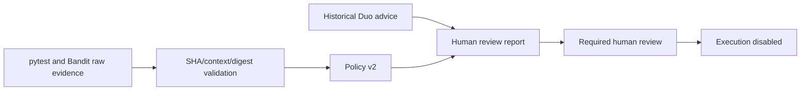

# Agent autonomy and trust boundaries

```text
AUTONOMY_STATUS=ASSISTED_VERIFIED
SUPERVISED_STATUS=NOT_VERIFIED
PRODUCTION_EXECUTION_STATUS=DISABLED
```

GitLab Duo supplied a genuine historical Code Review recommendation. Codex, under
the user's engineering instructions, implemented the subsequent CI correction.
GitLab CI runs tests, scanning and evidence/policy jobs. ReleaseGate deterministically
decides eligibility. Humans review the resulting candidate; a separate trusted
approval/authorization composition would be needed to execute a future release.



There is no path from AI text to ApprovalFacts, trusted identity, executor selection,
release dispatch, commit or merge. ALLOW retains execution_authorized=false and
next gate HUMAN_APPROVAL. Production final without trusted human facts is DENY.
`release` remains DENY / exit 3 without effects.

The historical foundational review had broader requested/effective privileges than
this product's offline advisory loader. A local read-only component does not prove
the historical Flow was technically restricted to read-only. The Phase 2.5 security
restriction on invoking Fix Pipeline remains in force; Custom Flow setup and
Supervised/Hands-off workflows are NOT_VERIFIED.

The [official competition](https://gitlab-transcend.devpost.com/) defines autonomy
categories and lifecycle scope. This entry targets Path A / Best Assisted Agent.
Deployment is not a demonstrated capability; no deployment bonus is claimed.
